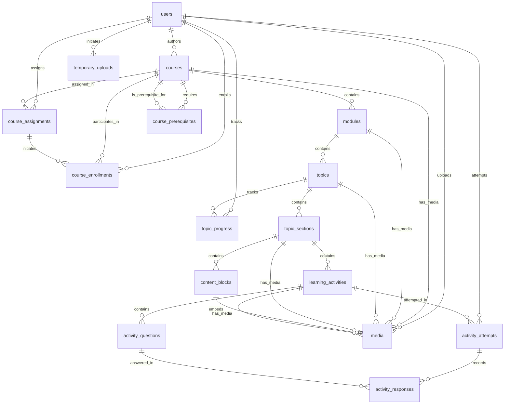

# LMS Database Schema Reference

This document defines the complete database architecture for the **Nexus LMS** learning management system. It builds upon the existing Laravel authentication, role-based access control (RBAC), activity auditing, notifications, and queue infrastructure, introducing a unified, modular content hierarchy, block-based display system, media management with temporary uploads, and learner progression schema.

---

## 1. Existing System Tables Retained

The existing core infrastructure tables remain unchanged and integrate seamlessly with the LMS schema:

| Category | Tables |
|---|---|
| **Identity & Authentication** | `users`, `password_reset_tokens`, `sessions` |
| **Access Control (RBAC/PBAC)** | `roles`, `permissions`, `model_has_roles`, `model_has_permissions`, `role_has_permissions` |
| **Auditing & Activity** | `activity_logs` |
| **Notifications** | `notifications` |
| **Queues & Jobs** | `jobs`, `job_batches`, `failed_jobs` |
| **Cache & System** | `cache`, `cache_locks`, `migrations` |

---

## 2. Learning Content Hierarchy & Display System

The LMS organizes educational content into a structured hierarchy with normalized display blocks:

```
Course
└── Module
    └── Topic
        └── Topic Section  (Learning Stages: Activate, Encode, Retrieve, Anchor, Deepen, Lab, Assessment, Custom)
            ├── Content Block  (Rich Text, Video, Code, Callout, Download, Embed - Normalized Display Items)
            └── Learning Activity  (Interactive, Gradable, Practice, Content, Simulation)
                └── Activity Question  (Multiple Choice, Fill-in-Blank, Matching, Ordering, Code, etc.)
```

### Pedagogical Learning Stages (`section_type`)

`topic_sections` uses a unified polymorphic design rather than fragmented individual stage tables. Any section can hold both content blocks and learning activities:

- **Activate**: Prior knowledge activation, priming questions, diagnostic warm-ups.
- **Encode**: Direct instruction, conceptual walkthroughs, guided interactive media.
- **Retrieve**: Active recall prompts, low-stakes comprehension checks, retrieval quizzes.
- **Anchor**: Real-world application case studies, scenario modeling, experiential analogies.
- **Deepen**: Advanced extension exercises, edge case challenges, synthesis questions.
- **Lab**: Hands-on sandbox exercises, guided technical walkthroughs, practical projects.
- **Assessment**: Formal graded evaluations, milestone checkpoints, summative tests.
- **Custom**: User-defined or domain-specific modular stages.

### Container Layout Types (`layout_type`)
`topic_sections.layout_type` sets the high-level grid/layout container:
- `'single_column'`: Standard reading and lecture flow.
- `'split_two_column'`: Left column (instruction/video) + Right column (notes/exercises).
- `'cinema_focus'`: Maximized video or interactive canvas with collapsible drawer.
- `'tabbed_stepper'`: Sequential tabbed reader or milestone walk-through.

---

## 3. Media & Upload Lifecycle

Media handling uses a two-phase lifecycle (**Temporary Uploads** $\rightarrow$ **Permanent Media**):

```
[React Frontend]
       │
       ▼ (1. Async Upload via dropzone / file picker)
[POST /api/uploads/temporary] ──► Stores file in temp storage & creates [temporary_uploads] record
       │
       ◄── Returns { token: "uuid-token", preview_url: "...", original_name: "..." }
       │
       ▼ (2. User Submits Form with { banner_upload_token: "uuid-token" })
[POST /courses]
       │
       ├──► Finds record in [temporary_uploads] by token
       ├──► Moves file to permanent directory (e.g., courses/{id}/banner.webp)
       ├──► Creates permanent record in [media] (mediable_type: 'Course', mediable_id: 1, collection: 'banner')
       └──► Deletes record in [temporary_uploads]
```

---

## 4. Entity Relationship Diagram (ERD)



---

## 5. Media & Upload Tables

### 5.1. `media`
Stores permanent uploaded files associated polymorphically with any system model.

| Column | Type | Nullable | Default | Description |
|---|---|---|---|---|
| `id` | `bigint unsigned` PK | No | Auto | Unique identifier |
| `uuid` | `uuid` | No | Unique | Publicly safe unique identifier |
| `mediable_type` | `varchar(128)` | No | — | Polymorphic model class (`App\Models\User`, `App\Models\Course`, etc.) |
| `mediable_id` | `bigint unsigned` | No | — | Polymorphic model primary key ID |
| `collection_name` | `varchar(64)` | No | `'default'` | Slot/collection: `'avatar'`, `'banner'`, `'thumbnail'`, `'content_embed'`, `'attachment'` |
| `file_name` | `varchar(255)` | No | — | Stored file name on disk (e.g. `banner_98f12.webp`) |
| `original_name` | `varchar(255)` | No | — | Original uploaded file name (e.g. `course-hero.png`) |
| `mime_type` | `varchar(128)` | No | — | MIME type (`image/webp`, `image/jpeg`, `video/mp4`, `application/pdf`) |
| `disk` | `varchar(64)` | No | `'public'` | Storage disk (`'public'`, `'s3'`, `'local'`) |
| `size_bytes` | `bigint unsigned` | No | — | File size in bytes |
| `width` | `unsigned int` | Yes | `null` | Image/video pixel width |
| `height` | `unsigned int` | Yes | `null` | Image/video pixel height |
| `custom_properties` | `json` | Yes | `null` | Alt text, caption, focal point, blurhash placeholder |
| `conversions` | `json` | Yes | `null` | Responsive formats/thumbnails (`thumb`, `preview`, `large`) |
| `position` | `unsigned integer` | No | `0` | Order index for multi-image collections/galleries |
| `uploaded_by` | `bigint unsigned` FK | Yes | `null` | FK → `users.id` (ON DELETE SET NULL) |
| `created_at` | `timestamp` | No | Current | Record creation timestamp |
| `updated_at` | `timestamp` | No | Current | Record update timestamp |
| `deleted_at` | `timestamp` | Yes | `null` | Soft deletion timestamp |

**Indexes & Constraints:**
- `UNIQUE (uuid)`
- `INDEX (mediable_type, mediable_id, collection_name)`
- `INDEX (uploaded_by)`

---

### 5.2. `temporary_uploads`
Ephemeral staging table for async uploads before parent entity persistence.

| Column | Type | Nullable | Default | Description |
|---|---|---|---|---|
| `id` | `bigint unsigned` PK | No | Auto | Unique identifier |
| `token` | `uuid` | No | Unique | Client reference token returned on upload |
| `user_id` | `bigint unsigned` FK | Yes | `null` | FK → `users.id` (uploader; null if guest/pre-auth) |
| `disk` | `varchar(64)` | No | `'public'` | Staging storage disk |
| `file_path` | `varchar(500)` | No | — | Relative path on disk (e.g. `temp/2026-11/abc-123.jpg`) |
| `original_name` | `varchar(255)` | No | — | Original client file name |
| `mime_type` | `varchar(128)` | No | — | Detected MIME type |
| `size_bytes` | `bigint unsigned` | No | — | File size in bytes |
| `metadata` | `json` | Yes | `null` | Dimensions, proposed collection, checksum |
| `expires_at` | `timestamp` | No | — | Auto-cleanup cutoff timestamp (e.g. `now() + 24 hours`) |
| `created_at` | `timestamp` | No | Current | Record creation timestamp |
| `updated_at` | `timestamp` | No | Current | Record update timestamp |

**Indexes & Constraints:**
- `UNIQUE (token)`
- `INDEX (expires_at)`
- `INDEX (user_id)`

---

## 6. Content Structure & Display Tables

### 6.1. `courses`
Represents an individual course offering or curriculum.

| Column | Type | Nullable | Default | Description |
|---|---|---|---|---|
| `id` | `bigint unsigned` PK | No | Auto | Unique identifier |
| `title` | `varchar(255)` | No | — | Course title |
| `slug` | `varchar(255)` | No | — | Unique URL-friendly slug (`courses_slug_unique`) |
| `description` | `text` | Yes | `null` | Course summary / prospectus |
| `thumbnail_url` | `varchar(500)` | Yes | `null` | Optional denormalized fast-access card thumbnail |
| `banner_url` | `varchar(500)` | Yes | `null` | Optional denormalized fast-access course hero banner |
| `status` | `varchar(32)` | No | `'draft'` | Course lifecycle: `'draft'`, `'published'`, `'archived'` |
| `settings` | `json` | Yes | `null` | Course-level flags, access rules, completion criteria |
| `created_by` | `bigint unsigned` FK | Yes | `null` | FK → `users.id` (ON DELETE SET NULL) |
| `published_at` | `timestamp` | Yes | `null` | Public release timestamp |
| `created_at` | `timestamp` | No | Current | Record creation timestamp |
| `updated_at` | `timestamp` | No | Current | Record update timestamp |
| `deleted_at` | `timestamp` | Yes | `null` | Soft deletion timestamp |

**Indexes & Constraints:**
- `UNIQUE (slug)`
- `INDEX (status)`
- `INDEX (created_by)`

---

### 6.2. `course_prerequisites`
Many-to-many relationship defining prerequisites for courses and auto-enrollment behavior.

| Column | Type | Nullable | Default | Description |
|---|---|---|---|---|
| `id` | `bigint unsigned` PK | No | Auto | Unique identifier |
| `course_id` | `bigint unsigned` FK | No | — | Target course (FK → `courses.id`, ON DELETE CASCADE) |
| `prerequisite_course_id` | `bigint unsigned` FK | No | — | Prerequisite course required (FK → `courses.id`, ON DELETE CASCADE) |
| `auto_enroll` | `boolean` | No | `true` | Automatically enroll learner into prerequisite when target course is assigned |
| `created_at` | `timestamp` | No | Current | Record creation timestamp |
| `updated_at` | `timestamp` | No | Current | Record update timestamp |

**Indexes & Constraints:**
- `UNIQUE (course_id, prerequisite_course_id)`

---

### 6.3. `modules`
High-level curriculum chapters or units inside a course.

| Column | Type | Nullable | Default | Description |
|---|---|---|---|---|
| `id` | `bigint unsigned` PK | No | Auto | Unique identifier |
| `course_id` | `bigint unsigned` FK | No | — | FK → `courses.id` (ON DELETE CASCADE) |
| `title` | `varchar(255)` | No | — | Module title |
| `description` | `text` | Yes | `null` | Module overview / learning objectives |
| `position` | `unsigned integer` | No | `0` | Order of display within the course |
| `is_published` | `boolean` | No | `false` | Visibility flag |
| `settings` | `json` | Yes | `null` | Module-specific options |
| `created_at` | `timestamp` | No | Current | Record creation timestamp |
| `updated_at` | `timestamp` | No | Current | Record update timestamp |

**Indexes & Constraints:**
- `UNIQUE (course_id, position)`
- `INDEX (course_id)`

---

### 6.3. `topics`
Focused instructional lessons or units within a module.

| Column | Type | Nullable | Default | Description |
|---|---|---|---|---|
| `id` | `bigint unsigned` PK | No | Auto | Unique identifier |
| `module_id` | `bigint unsigned` FK | No | — | FK → `modules.id` (ON DELETE CASCADE) |
| `title` | `varchar(255)` | No | — | Topic title |
| `slug` | `varchar(255)` | No | — | Topic slug unique within the module |
| `description` | `text` | Yes | `null` | Brief topic overview |
| `position` | `unsigned integer` | No | `0` | Order of display within the module |
| `estimated_minutes` | `unsigned integer` | Yes | `null` | Estimated completion time in minutes |
| `is_published` | `boolean` | No | `false` | Visibility flag |
| `settings` | `json` | Yes | `null` | Topic-specific options |
| `created_at` | `timestamp` | No | Current | Record creation timestamp |
| `updated_at` | `timestamp` | No | Current | Record update timestamp |

**Indexes & Constraints:**
- `UNIQUE (module_id, position)`
- `UNIQUE (module_id, slug)`
- `INDEX (module_id)`

---

### 6.4. `topic_sections`
Unified stages inside a topic with configurable container layouts.

| Column | Type | Nullable | Default | Description |
|---|---|---|---|---|
| `id` | `bigint unsigned` PK | No | Auto | Unique identifier |
| `topic_id` | `bigint unsigned` FK | No | — | FK → `topics.id` (ON DELETE CASCADE) |
| `section_type` | `varchar(64)` | No | — | Stage type: `'activate'`, `'encode'`, `'retrieve'`, `'anchor'`, `'deepen'`, `'lab'`, `'assessment'` |
| `layout_type` | `varchar(64)` | No | `'single_column'` | Container layout: `'single_column'`, `'split_two_column'`, `'cinema_focus'`, `'tabbed_stepper'` |
| `title` | `varchar(255)` | No | — | Section title |
| `instructions` | `text` | Yes | `null` | Learner guidance or instructions |
| `content` | `json` | Yes | `null` | Optional section-level fallback content |
| `presentation_config` | `json` | Yes | `null` | Layout configuration / responsive options |
| `position` | `unsigned integer` | No | `0` | Order within the topic |
| `is_required` | `boolean` | No | `true` | Required for topic completion |
| `is_published` | `boolean` | No | `false` | Visibility flag |
| `settings` | `json` | Yes | `null` | Additional configuration |
| `created_at` | `timestamp` | No | Current | Record creation timestamp |
| `updated_at` | `timestamp` | No | Current | Record update timestamp |

**Indexes & Constraints:**
- `UNIQUE (topic_id, position)`
- `INDEX (topic_id, section_type)`
- `INDEX (layout_type)`

---

### 6.5. `content_blocks` (Normalized Display Content)
Individual modular blocks of displayable content inside a section.

| Column | Type | Nullable | Default | Description |
|---|---|---|---|---|
| `id` | `bigint unsigned` PK | No | Auto | Unique identifier |
| `topic_section_id` | `bigint unsigned` FK | No | — | FK → `topic_sections.id` (ON DELETE CASCADE) |
| `block_type` | `varchar(64)` | No | — | `'rich_text'`, `'video'`, `'audio'`, `'code'`, `'callout'`, `'download'`, `'embed'` |
| `display_variant` | `varchar(64)` | No | `'default'` | `'default'`, `'card'`, `'banner'`, `'hero'`, `'accordion'`, `'callout_tip'` |
| `layout_slot` | `varchar(32)` | No | `'main'` | Slot in parent layout: `'main'`, `'left'`, `'right'`, `'sidebar'`, `'full'` |
| `content` | `json` | Yes | `null` | Block text, HTML, code snippets, or configuration |
| `media_id` | `bigint unsigned` FK | Yes | `null` | FK → `media.id` (ON DELETE SET NULL) for attached video/image/document |
| `position` | `unsigned integer` | No | `0` | Order within the section |
| `is_visible` | `boolean` | No | `true` | Visibility toggle per block |
| `created_at` | `timestamp` | No | Current | Record creation timestamp |
| `updated_at` | `timestamp` | No | Current | Record update timestamp |

**Indexes & Constraints:**
- `UNIQUE (topic_section_id, position)`
- `INDEX (topic_section_id, layout_slot)`
- `INDEX (block_type)`

---

### 6.6. `learning_activities`
Interactive, gradable, practice, or content activities within a topic section.

| Column | Type | Nullable | Default | Description |
|---|---|---|---|---|
| `id` | `bigint unsigned` PK | No | Auto | Unique identifier |
| `topic_section_id` | `bigint unsigned` FK | No | — | FK → `topic_sections.id` (ON DELETE CASCADE) |
| `activity_type` | `varchar(64)` | No | — | `'quiz'`, `'simulation'`, `'reflection'`, `'interactive'`, `'practice'`, `'lab'` |
| `title` | `varchar(255)` | No | — | Activity title |
| `instructions` | `text` | Yes | `null` | Learner instructions |
| `content` | `json` | Yes | `null` | Activity-level content / scenario context |
| `presentation_config` | `json` | Yes | `null` | Frontend component renderer key, theme, variant |
| `grading_config` | `json` | Yes | `null` | Passing threshold, retake limits, score weighting |
| `is_answerable` | `boolean` | No | `false` | Whether it accepts learner input/responses |
| `is_gradable` | `boolean` | No | `false` | Whether attempts generate points/grades |
| `max_score` | `decimal(8,2)` | Yes | `null` | Maximum points attainable |
| `position` | `unsigned integer` | No | `0` | Order within the topic section |
| `is_required` | `boolean` | No | `true` | Required for section completion |
| `is_published` | `boolean` | No | `false` | Visibility flag |
| `settings` | `json` | Yes | `null` | Extensible activity settings |
| `created_at` | `timestamp` | No | Current | Record creation timestamp |
| `updated_at` | `timestamp` | No | Current | Record update timestamp |

**Indexes & Constraints:**
- `UNIQUE (topic_section_id, position)`
- `INDEX (topic_section_id, activity_type)`

---

### 6.7. `activity_questions`
Individual question items belonging to an answerable/gradable learning activity.

| Column | Type | Nullable | Default | Description |
|---|---|---|---|---|
| `id` | `bigint unsigned` PK | No | Auto | Unique identifier |
| `learning_activity_id` | `bigint unsigned` FK | No | — | FK → `learning_activities.id` (ON DELETE CASCADE) |
| `question_type` | `varchar(64)` | No | — | `'multiple_choice'`, `'true_false'`, `'fill_blank'`, `'matching'`, `'ordering'`, `'short_answer'`, `'code'` |
| `prompt` | `json` | No | — | Prompt content, questions text, rich blocks |
| `question_config` | `json` | Yes | `null` | Options, shuffle flags, layout (Client-safe) |
| `answer_key` | `json` | Yes | `null` | **Server-side only**: Correct answers, rubric, or evaluator regex |
| `grading_config` | `json` | Yes | `null` | Partial credit rules, case sensitivity, penalties |
| `explanation` | `json` | Yes | `null` | Rationales / explanations shown after grading |
| `points` | `decimal(8,2)` | No | `1.00` | Points value of this question |
| `position` | `unsigned integer` | No | `0` | Question order within activity |
| `is_required` | `boolean` | No | `true` | Whether answering this question is required |
| `created_at` | `timestamp` | No | Current | Record creation timestamp |
| `updated_at` | `timestamp` | No | Current | Record update timestamp |

**Indexes & Constraints:**
- `UNIQUE (learning_activity_id, position)`
- `INDEX (learning_activity_id, question_type)`

---

## 7. Learner Progression & Attempts

### 7.1. `activity_attempts`
| Column | Type | Nullable | Default | Description |
|---|---|---|---|---|
| `id` | `bigint unsigned` PK | No | Auto | Unique identifier |
| `learning_activity_id` | `bigint unsigned` FK | No | — | FK → `learning_activities.id` (ON DELETE CASCADE) |
| `user_id` | `bigint unsigned` FK | No | — | FK → `users.id` (ON DELETE CASCADE) |
| `attempt_number` | `unsigned integer` | No | `1` | Sequential attempt counter per user/activity |
| `status` | `varchar(32)` | No | `'in_progress'` | `'in_progress'`, `'submitted'`, `'graded'`, `'abandoned'` |
| `score` | `decimal(8,2)` | Yes | `null` | Earned points |
| `max_score` | `decimal(8,2)` | Yes | `null` | Point baseline snapshot at attempt creation |
| `started_at` | `timestamp` | No | Current | When the attempt began |
| `submitted_at` | `timestamp` | Yes | `null` | Learner final submission timestamp |
| `graded_at` | `timestamp` | Yes | `null` | Automated or instructor grading timestamp |
| `grading_summary` | `json` | Yes | `null` | Detailed breakdown of points and feedback |
| `created_at` | `timestamp` | No | Current | Record creation timestamp |
| `updated_at` | `timestamp` | No | Current | Record update timestamp |

---

### 7.2. `activity_responses`
| Column | Type | Nullable | Default | Description |
|---|---|---|---|---|
| `id` | `bigint unsigned` PK | No | Auto | Unique identifier |
| `activity_attempt_id` | `bigint unsigned` FK | No | — | FK → `activity_attempts.id` (ON DELETE CASCADE) |
| `activity_question_id` | `bigint unsigned` FK | No | — | FK → `activity_questions.id` (ON DELETE CASCADE) |
| `response` | `json` | Yes | `null` | Submitted response payload (option IDs, text, maps) |
| `is_correct` | `boolean` | Yes | `null` | Boolean correctness result |
| `score` | `decimal(8,2)` | Yes | `null` | Points awarded for this response |
| `feedback` | `json` | Yes | `null` | Formative feedback or automated evaluator report |
| `answered_at` | `timestamp` | Yes | `null` | Timestamp when question was answered |
| `created_at` | `timestamp` | No | Current | Record creation timestamp |
| `updated_at` | `timestamp` | No | Current | Record update timestamp |

---

### 7.3. `topic_progress`
| Column | Type | Nullable | Default | Description |
|---|---|---|---|---|
| `id` | `bigint unsigned` PK | No | Auto | Unique identifier |
| `topic_id` | `bigint unsigned` FK | No | — | FK → `topics.id` (ON DELETE CASCADE) |
| `user_id` | `bigint unsigned` FK | No | — | FK → `users.id` (ON DELETE CASCADE) |
| `status` | `varchar(32)` | No | `'not_started'` | `'not_started'`, `'in_progress'`, `'completed'` |
| `progress_percent` | `decimal(5,2)` | No | `0.00` | Percentage of required sections completed (0–100) |
| `started_at` | `timestamp` | Yes | `null` | First interaction timestamp |
| `completed_at` | `timestamp` | Yes | `null` | Completion criteria satisfied timestamp |
| `last_activity_at` | `timestamp` | Yes | `null` | Most recent activity timestamp |
| `settings` | `json` | Yes | `null` | State bookmarks |
| `created_at` | `timestamp` | No | Current | Record creation timestamp |
| `updated_at` | `timestamp` | No | Current | Record update timestamp |

---

### 7.4. `course_assignments`
| Column | Type | Nullable | Default | Description |
|---|---|---|---|---|
| `id` | `bigint unsigned` PK | No | Auto | Unique identifier |
| `course_id` | `bigint unsigned` FK | No | — | FK → `courses.id` (ON DELETE CASCADE) |
| `assigned_by` | `bigint unsigned` FK | Yes | `null` | FK → `users.id` (ON DELETE SET NULL) |
| `target_type` | `varchar(64)` | No | — | Polymorphic target: `'user'`, `'cohort'`, `'group'`, `'role'` |
| `target_id` | `bigint unsigned` | No | — | Identifier of targeted entity |
| `due_at` | `timestamp` | Yes | `null` | Due date deadline |
| `available_from` | `timestamp` | Yes | `null` | Earliest access timestamp |
| `available_until` | `timestamp` | Yes | `null` | Access expiration timestamp |
| `required` | `boolean` | No | `true` | Mandatory vs. optional enrollment |
| `settings` | `json` | Yes | `null` | Custom assignment settings |
| `created_at` | `timestamp` | No | Current | Record creation timestamp |
| `updated_at` | `timestamp` | No | Current | Record update timestamp |

---

### 7.5. `course_enrollments`
| Column | Type | Nullable | Default | Description |
|---|---|---|---|---|
| `id` | `bigint unsigned` PK | No | Auto | Unique identifier |
| `course_id` | `bigint unsigned` FK | No | — | FK → `courses.id` (ON DELETE CASCADE) |
| `user_id` | `bigint unsigned` FK | No | — | FK → `users.id` (ON DELETE CASCADE) |
| `course_assignment_id` | `bigint unsigned` FK | Yes | `null` | FK → `course_assignments.id` (ON DELETE SET NULL) |
| `status` | `varchar(32)` | No | `'enrolled'` | `'enrolled'`, `'in_progress'`, `'completed'`, `'withdrawn'` |
| `enrolled_at` | `timestamp` | No | Current | Enrollment timestamp |
| `started_at` | `timestamp` | Yes | `null` | First lesson view timestamp |
| `completed_at` | `timestamp` | Yes | `null` | Final completion timestamp |
| `progress_percent` | `decimal(5,2)` | No | `0.00` | Overall course completion percentage (0–100) |
| `settings` | `json` | Yes | `null` | Grade snapshots, certificates issued |
| `created_at` | `timestamp` | No | Current | Record creation timestamp |
| `updated_at` | `timestamp` | No | Current | Record update timestamp |

---

## 8. Optional Content Type Registry

### 8.1. `content_type_definitions`
| Column | Type | Nullable | Default | Description |
|---|---|---|---|---|
| `id` | `bigint unsigned` PK | No | Auto | Unique identifier |
| `scope` | `varchar(32)` | No | — | Target level: `'section'`, `'block'`, `'activity'`, `'question'` |
| `type_key` | `varchar(64)` | No | — | Canonical key (e.g. `'matching'`, `'code_sandbox'`) |
| `label` | `varchar(255)` | No | — | Human-readable name for course builder UI |
| `config_schema` | `json` | Yes | `null` | JSON Schema for validating author input |
| `default_config` | `json` | Yes | `null` | Default configuration template |
| `renderer_key` | `varchar(128)` | Yes | `null` | React frontend component registry identifier |
| `version` | `unsigned integer` | No | `1` | Schema version |
| `is_enabled` | `boolean` | No | `true` | Availability toggle |
| `created_at` | `timestamp` | No | Current | Record creation timestamp |
| `updated_at` | `timestamp` | No | Current | Record update timestamp |

---

## 9. How Presentation Works: React Layout & Block Rendering

```tsx
// Example TopicSectionViewer in React:
export function TopicSectionViewer({ section }) {
  // 1. Pick container layout (SingleColumnLayout, SplitTwoColumnLayout, etc.)
  const LayoutComponent = layoutRegistry[section.layout_type] || SingleColumnLayout;

  return (
    <LayoutComponent section={section}>
      {section.blocks.map((block) => (
        <BlockRenderer key={block.id} block={block} />
      ))}
      {section.activities.map((activity) => (
        <ActivityRenderer key={activity.id} activity={activity} />
      ))}
    </LayoutComponent>
  );
}
```
